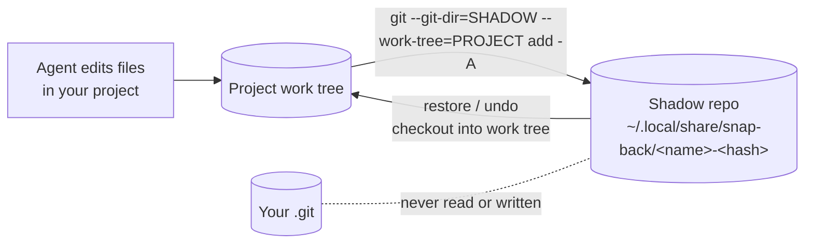

# snap-back

English | [简体中文](README.zh-CN.md)

Roll back whatever a coding agent did to your files with one command, including what built-in editor checkpoints cannot, without touching your own git history.

An agent overwrites your `.env`, deletes an untracked data file, or runs `rm -rf` through a shell command. Claude Code `/rewind` and Cursor checkpoints undo tracked edits the agent made with their own tools, but not files they never tracked and not side effects of shell commands. snap-back does. It snapshots the whole project, tracked, untracked and gitignored alike, before and during an agent's work, so one command brings it all back.

It works with any agent (Codex, Claude Code, OpenCode, Cursor, Aider, Gemini CLI, or a script you wrote) because it watches files, not the agent, which also covers the agents that have no undo of their own.

### When you do not need snap-back

If you only use Claude Code and only ever undo edits it made through its own file tools, `/rewind` already covers that and is always on. snap-back earns its place when the agent has no native undo (Codex, Aider, Gemini CLI, Cursor CLI), or when the thing to undo is outside tracked files: a deleted untracked or gitignored file, an `rm -rf` of a data directory, a `.env` overwritten, or any file a shell command the agent ran changed.

[](https://github.com/Abelo9996/snap-back/actions/workflows/ci.yml)


## Quickstart

Requires Node 20 or newer and git on your PATH.

```bash
# Run your agent between two checkpoints
npx @abelo9996/snap-back wrap -- codex

# Didn't like the result? See what it changed, then roll it back
npx @abelo9996/snap-back diff
npx @abelo9996/snap-back undo
```

`undo` shows the files it will restore and delete and asks before changing anything. To stop typing `npx @abelo9996/snap-back ...`, install it once:

```bash
npm install -g @abelo9996/snap-back
snap-back undo
```

Homebrew (macOS and Linux): `brew install abelo9996/tap/snap-back` installs the same `snap-back` command.

No daemon running yet? `npx @abelo9996/snap-back` with no command takes a checkpoint right now and prints the one command that gives you continuous coverage for the agents it detects.

## What built-in checkpoints miss

Two real runs on macOS, in throwaway git repos, each with a gitignored `.env`, a gitignored data file, a plain untracked file, and `node_modules/`. Each agent was told to rewrite a tracked file, delete files, overwrite `.env` from `.env.example`, and delete files through a shell command. Then one `snap-back undo`.

**Codex CLI** (`codex exec`), which has no undo of its own:

```bash
snap-back wrap -- codex exec --dangerously-bypass-approvals-and-sandbox "<destructive task>"
# snap-back: codex changed 5 files. Review with `snap-back diff`, roll back with `snap-back undo`.
snap-back undo --yes
# 5 files restored, 3 deleted files brought back. Includes .env.
```

Restored: the gitignored `.env` (its real secret, not the `.env.example` the agent copied over it), the gitignored `data/cache.bin`, the untracked `scratch.out`, the deleted tracked `notes.txt`, and the rewritten `src/app.js`.

**Claude Code** (`claude -p`), to show what `/rewind` would not reach:

```bash
snap-back wrap -- claude -p "<destructive task>" --dangerously-skip-permissions
# snap-back: claude changed 4 files.
snap-back undo --yes
# 4 files restored, 2 deleted files brought back. Includes .env.
```

Restored: the gitignored `.env`, the gitignored `data/seed.csv`, the untracked `build.tmp`, and the rewritten `src/version.js`. The three non-tracked items are exactly what `/rewind` leaves behind, because the shell deletions happened outside the file tools it checkpoints.

`undo` and `restore` print that before/after summary, name the secrets among the files, and, for a big directory too large to store such as `node_modules/`, print its size and the command to rebuild it. Add `--card` to write a small share card (SVG, plus PNG when a renderer is available).

## Install as a Claude Code plugin

Inside Claude Code:

```text
/plugin marketplace add Abelo9996/open-agent-lab
/plugin install snap-back@open-agent-lab
```

Then run `/reload-plugins` or start a new session. The plugin adds the snap-back skill, the commands `/snap-back:undo` (preview, then roll back the last burst or a snapshot id), `/snap-back:list` and `/snap-back:status`, and the same `UserPromptSubmit`, `PreToolUse` and `PostToolUse` hooks that `snap-back hooks install` writes, without editing any settings file. Do not also run `snap-back hooks install`, or both sets of hooks run. From a shell: `claude plugin marketplace add Abelo9996/open-agent-lab`, then `claude plugin install snap-back@open-agent-lab`. Needs Claude Code 2.1.139 or newer, Node 20+ and git.

The hooks need no install step: without a global install they run `npx -y @abelo9996/snap-back`, which downloads the package on first use. Measured on an Apple M-series laptop, a hook call takes about 0.5 s through npx and about 0.2 s once snap-back is installed globally, which the plugin uses automatically when it is on PATH:

```bash
npm install -g @abelo9996/snap-back
```

A file-changing tool call waits for one hook; the snapshot after the call runs in the background.

## Install as a Codex plugin

```bash
codex plugin marketplace add Abelo9996/open-agent-lab
codex plugin add snap-back@open-agent-lab
```

This adds the snap-back skill, so Codex checkpoints before risky changes and can roll back when you ask. Codex has no snap-back hooks yet; for automatic checkpoints around a whole session, start it with `snap-back wrap -- codex`.

## Safety: what it touches and what it never touches

snap-back writes to:

- **Its own storage directory**, one shadow git repository per project:
  - Linux: `$XDG_DATA_HOME/snap-back/` (default `~/.local/share/snap-back/`)
  - macOS: `~/Library/Application Support/snap-back/`
  - Windows: `%LOCALAPPDATA%\snap-back\`
  - Override with `SNAP_BACK_HOME` (`SNAPBACK_HOME` is still read).
  - If a `snapback` directory from a version before the rename exists in that location, it keeps being used, so existing snapshots stay available.
- **Files in your project, only when you run `undo` or `restore`**, and only after showing you the list and getting a yes (or `--yes`). Before every restore it records a safety snapshot of the current files, so a restore can itself be undone. A restore never deletes a file snap-back never recorded (the built-in big directories, `.snapbackignore` paths, or files over the size cap); those are left exactly as they are. If you press Ctrl-C during a snapshot or restore, snap-back finishes it first, so the project is never left half-restored.
- **`.claude/settings.local.json`, only when you run `snap-back hooks install`** (or `.claude/settings.json` with `--shared`). Existing settings are merged, never replaced, and the previous file is copied to `<file>.snap-back-backup-<timestamp>` first.

snap-back never touches:

- Your project's `.git` directory: no commits, branches, tags, index changes, stashes or config. Every git call uses an explicit `--git-dir` pointing at the shadow repository, and inherited `GIT_*` environment variables are stripped. The test suite hashes every file in `.git` before and after a full snapshot, restore, undo and gc cycle and requires them to be identical.
- The built-in big directories (matched at any depth, like `.gitignore` patterns): `node_modules/`, `.venv/`, `venv/`, `__pycache__/`, `dist/`, `build/`, `out/`, `target/`, `.next/`, `.nuxt/`, `.svelte-kit/`, `.turbo/`, `.cache/`, `coverage/`, `.gradle/`, `.terraform/` and a few others (see `BUILTIN_IGNORES` in `src/store.ts`), paths you list in `.snap-back-ignore`, and files over the per-file size cap. These are never saved, so a restore never deletes or overwrites them. Their existence and size are recorded, so a restore can tell you one is gone and how to rebuild it. Unlike plain git, files your `.gitignore` excludes (such as `.env` and local data) **are** saved and restored, under the size cap.
- Anything outside the project directory. snap-back refuses to run with your home directory or a filesystem root as the project.

Gitignored files such as `.env` are stored in the shadow repository so they can be brought back. If a file must never be copied, even into snap-back's own storage, list it in `.snap-back-ignore`. The per-file size cap is `SNAP_BACK_MAX_FILE_MB` (default 5).

## How it works



Each snapshot is a commit in the shadow repository. Its tree is the full set of files at that moment, tracked, untracked and gitignored, minus the built-in big directories and files over the size cap, so restoring is exact: modified files get their old contents back, deleted files reappear (including untracked and gitignored ones a shell command removed), and files that did not exist in the snapshot are removed (along with directories that become empty). Unchanged files are stored once, so frequent snapshots are cheap.

Every snapshot has a kind. `undo` rolls back to the newest "before" marker whose files differ from what you have now:

| Kind | Recorded by | Marks the start of a burst |
| --- | --- | --- |
| `manual` | `snap-back snap` | yes |
| `wrap-start`, `wrap`, `wrap-end` | `snap-back wrap` | `wrap-start` |
| `turn-start`, `pre-tool`, `post-tool` | Claude Code hooks | `turn-start` (each prompt you send) |
| `watch-start`, `watch` | `snap-back watch` | yes, each debounced burst |
| `safety`, `restore` | `undo` and `restore` | `restore` |

Running `undo` twice walks back two bursts. When there is nothing older, `undo` says so and changes nothing; it never re-applies what an earlier undo removed. To reverse an undo, run the `snap-back restore <id>` command it printed.

## Setup per agent

| Agent | Setup | Granularity of `undo` |
| --- | --- | --- |
| Claude Code | the [plugin](#install-as-a-claude-code-plugin), or `snap-back hooks install --agent claude` | the last prompt's changes; every Edit, Write, MultiEdit, NotebookEdit, Bash and PowerShell call is also checkpointed |
| Codex CLI | `snap-back wrap -- codex` | the whole session, plus a snapshot every 30 s while it runs |
| OpenCode, Aider, Gemini CLI, any CLI agent | `snap-back wrap -- <command>` | the whole session |
| Cursor, IDE agents, anything else | `snap-back watch` in a terminal | each burst of changes (1.5 s of quiet ends a burst) |

### Claude Code

```bash
snap-back hooks install --agent claude           # writes .claude/settings.local.json
snap-back hooks install --agent claude --shared  # writes .claude/settings.json instead
snap-back hooks status                           # reports both files
snap-back hooks uninstall                        # removes the hooks from both files
```

The hooks run `snap-back hook claude` on `UserPromptSubmit`, `PreToolUse` and `PostToolUse`. The hook always exits 0 and prints nothing to stdout, so it can never block a tool call or inject text into the conversation.

By default the hooks go into `.claude/settings.local.json`, which holds your personal settings and is not meant to be committed. If git lists it as untracked, add it to `.gitignore`. Use `--shared` to write `.claude/settings.json`, which projects usually commit, when everyone on the project should get the hooks.

If snap-back is not installed globally, the hook command points at the absolute path of the copy you ran (for `npx`, a directory in the npx cache). That path exists only on your machine, so `--shared` prints a warning in that case. Run `npm install -g @abelo9996/snap-back` first to get the portable `snap-back hook claude` command, then install the hooks. Use `--command <cmd>` to set the command yourself.

`uninstall` takes `--shared` or `--local` to clean only one file. Reinstalling replaces hook entries from an earlier install that used a different command, including the `snapback hook claude` form from before the rename.

Claude Code's built-in rewind covers edits made through its own file tools. snap-back also covers files changed by shell commands (`rm`, codemods, formatters, generators) and works the same way across every agent you use.

### Agent Skill

`skills/snap-back/SKILL.md` teaches an agent to checkpoint before risky edits and how to roll back. Install it with:

```bash
npx skills add Abelo9996/snap-back
```

## Commands

```text
snap-back                               (no command) checkpoint now, show how to get coverage
snap-back start                         the same zero-setup first run
snap-back snap [-m label]               take a snapshot now
snap-back list [-n 20] [--all] [--json] list snapshots, newest first
snap-back diff                          what `undo` would revert, grouped (deletions first)
snap-back diff <id> [<id2>] [--stat]    compare a snapshot with now, or two snapshots
snap-back undo [--dry-run] [--yes] [--card [path]]   roll back the last agent burst
snap-back restore <id> [--yes] [--card [path]] [-- <paths>...]
                                       restore everything, or only some paths
snap-back watch [--debounce 1500]       snapshot on file changes
snap-back wrap [--interval 30] -- <cmd> checkpoint, run cmd, checkpoint
snap-back hooks install|uninstall|status --agent claude [--shared|--local]
snap-back gc [--keep 100] [--keep-days 14] [--yes]
snap-back status
```

The per-file size cap for capturing untracked and gitignored files is `SNAP_BACK_MAX_FILE_MB` (default 5).

All commands accept `--dir <path>`. By default the project is the nearest directory, starting from the current one and walking up, that already has snapshots or contains `.git`; if there is none, it is the current directory. `undo`, `restore` and `wrap` print the project directory when it is not the current one.

Extra ignore patterns go in a `.snap-back-ignore` file at the project root (gitignore syntax). It is applied after the built-in list, so `!build/` there re-includes a built-in ignore. A `.snapbackignore` file from before the rename is still read.

## Limitations

- **Only files in the project are covered.** Database writes, network calls, deployed infrastructure, global package installs, pushed commits and messages sent cannot be undone by restoring files.
- `undo` reverts every file change since the marker it picks, including edits you made by hand after the agent finished. It lists the files first, and the safety snapshot it records keeps your edits, so `snap-back restore <safety-id> -- <path>` gets any of them back.
- The built-in big directories (`node_modules/`, `dist/`, caches) and files over the size cap are not stored. If an agent damages something inside one, reinstall or rebuild it; `undo` names the directory and its recorded size and, when it knows one, the rebuild command. Gitignored files that are not in a built-in big directory and are under the cap are stored and restored.
- Nested git repositories inside the project are recorded only as a pointer to their current commit, not their file contents; nested repositories with no commits are skipped. `undo` and `restore` list changed nested repositories as skipped instead of touching them, so if an agent deletes or rewrites one, recover it with its own git history.
- File watching (`watch`) can miss changes on network filesystems and some container mounts.
- Large binary files are stored in full each time they change. Run `snap-back gc` to prune old snapshots; ids of the remaining snapshots change after gc.
- On Windows, `wrap` runs the command through the shell so `.cmd` shims resolve; quote arguments accordingly.
- Agent detection in `watch` labels is a best-effort scan of the process list.

## Roadmap

- Hook integrations for more agents as they ship hook APIs (Codex, OpenCode, Cursor).
- `snap-back undo --interactive` to pick files from the last burst.
- Size limits for large binaries.
- A `snap-back log --agent <name>` filter and per-session grouping.

## Related projects

snap-back is part of a small set of tools for evaluating and living with coding agents:

- [nerf-watch](https://github.com/Abelo9996/nerf-watch): detects silent model and cost changes behind an API.
- [rerun-bench](https://github.com/Abelo9996/rerun-bench): measures how consistent an agent is across reruns of the same task.

## Contributing

See [CONTRIBUTING.md](CONTRIBUTING.md). Bug reports with a reproduction in a temp directory are the most useful kind.

## License

MIT. See [LICENSE](LICENSE).
